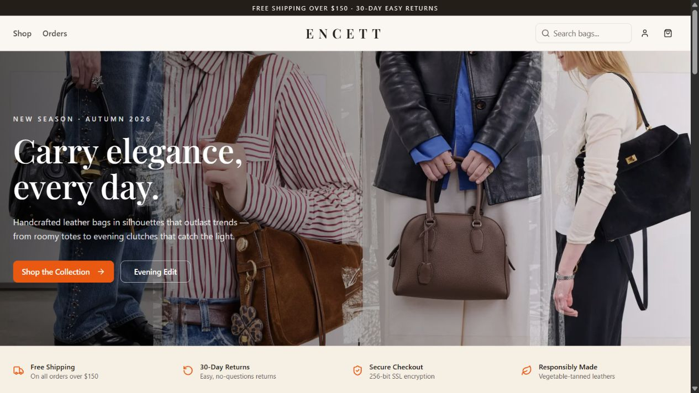

# ENCETT E-Commerce Platform

A leather-goods storefront with a product catalog, user authentication and order APIs.

**[Open live demo](https://encett-ecommerce.netlify.app/)** · [Features](#features) · [Run locally](#run-locally)

**Next.js · React · TypeScript · Tailwind CSS · Prisma**

## Preview

*Captured from the live application on 30 October 2026.*

## Features

- A product catalog presented through a responsive storefront.
- Account registration and sign-in.
- Order APIs and an orders interface.
- Prisma data access with SQLite for local development and PostgreSQL for Netlify deployment.

An admin role exists in the data model; an admin dashboard has not been implemented.

## Architecture

| Layer | Technology |
| --- | --- |
| Application | Next.js and React |
| Language & styling | TypeScript and Tailwind CSS |
| Database access | Prisma |
| Local database | SQLite |
| Hosted database | PostgreSQL through Netlify Database |
| Hosting | Netlify |

## Run locally

Requires Node.js 22.13 or newer and npm.

1. Run `npm install`.
2. Copy `.env.example` to `.env`.
3. Run `npx prisma generate`.
4. Create an empty `prisma/dev.db` file if it does not exist, then run `npx prisma db push`.
5. To populate a fresh local database, run `node --env-file=.env --experimental-strip-types scripts/seed.ts`. **This deletes existing records.**
6. Run `npx next dev -p 3000` and open http://localhost:3000.

The seed script creates demo accounts and 14 sample products. Demo credentials are for local development only; replace them before deploying. An admin role exists in the database, but an admin dashboard has not been implemented.

Local environment files, database files, dependencies, and build outputs are excluded from Git.

## Netlify deployment

Netlify uses `netlify.toml` and `npm run build:netlify`. This generates a PostgreSQL Prisma client from `prisma/schema.production.prisma`. Local development continues to use SQLite and `prisma/schema.prisma`; run `npm run db:generate` after switching back from a production build.

The Netlify build uses Webpack and a separate `.next-netlify` output directory to avoid Windows symlink and development-server file-lock conflicts. The production Prisma client includes the Linux engine required by Netlify Functions.

`@netlify/database` provisions persistent PostgreSQL storage. Committed migrations under `netlify/database/migrations/` create the schema and initial public catalog during deployment. Local users, passwords, sessions, and orders are not uploaded. Create your own account on the live site.

Keep both Prisma schemas in sync when changing models. Database credentials are managed by Netlify and must not be committed.
